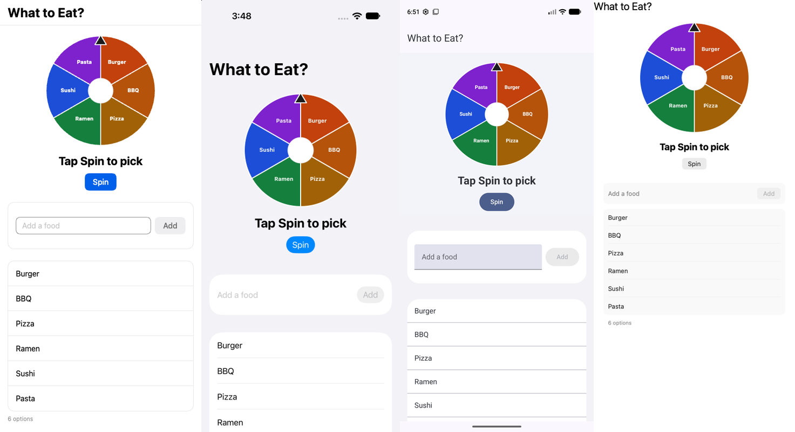
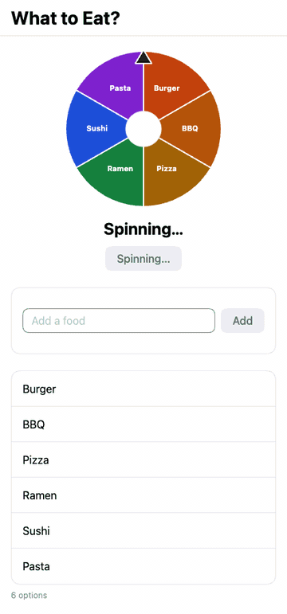
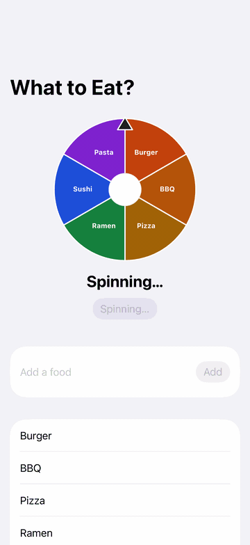
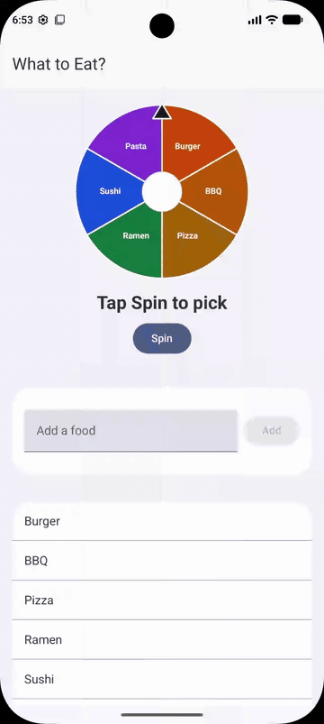
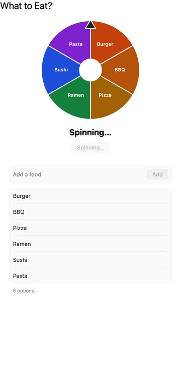
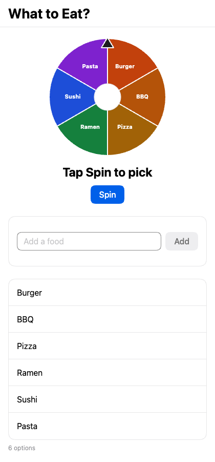
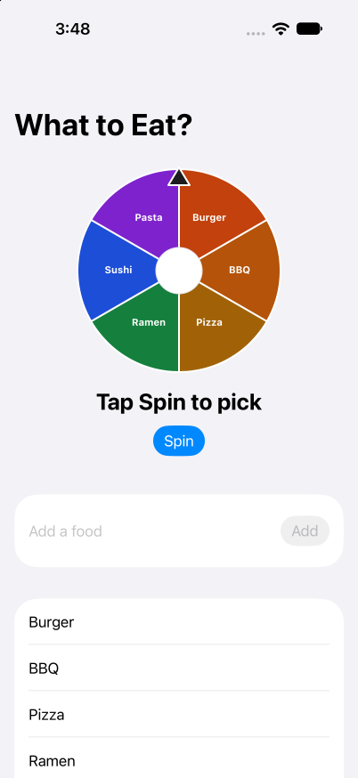
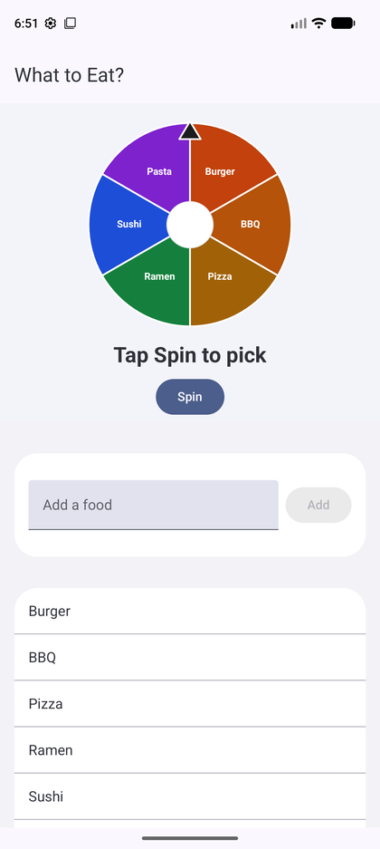

# What to Eat

A food roulette built with [Exact](https://github.com/expo/exact), Expo's agent-native app framework. One Contract file describes the UI; the same app runs natively on iOS, Android, macOS, and the web.



<p align="center">
  
  
  
  
</p>

<table>
  <tr>
    <th>Web</th>
    <th>iOS</th>
    <th>Android</th>
    <th>macOS</th>
  </tr>
  <tr valign="top">
    <td></td>
    <td></td>
    <td></td>
    <td></td>
  </tr>
</table>

## What is Exact, and why I used it

[Exact](https://github.com/expo/exact) is an early-preview app framework from Expo. You describe the interface in **Contract**, a small declarative language, and you write data logic in TypeScript or Rust. The compiler turns that interface into a compact plan:

- On the web, the plan becomes one ES module over a ~20 KB runtime that drives the real DOM.
- On macOS and iOS, a Rust runner executes the same plan, a Rust layout kernel computes every box with CSS rules, and each platform draws with its own tools — AppKit or UIKit. There is no webview and no JavaScript bridge in the UI.
- The same toolchain also builds and drives an Android app. This project was built and tested there too.

Exact is designed so an AI agent can make an app, run it, look at it, operate it, and prove it works, without a person in the loop. Ten operations — `tree`, `screenshot`, `tap`, `type`, `state`, `layout`, `logs`, `clock`, `prefer`, `perf` — drive every host the same way. Tests are scripts of those operations, and an `app.test.contract` file runs unchanged on any host.

I built this roulette to learn that loop end to end: one small codebase, four native hosts, and the same three tests passing on each of them.

> Exact is pre-1.0 and changes daily. There is no API stability, no backwards compatibility, and no migration guide, by design. See the [Exact repository](https://github.com/expo/exact).

## Features

- An SVG wheel with a colored slice per food
- A CSS `rotate` transition of about three seconds, with four extra turns so the spin reads as a spin
- A deterministic, seeded pick so tests can assert the winner
- Add a food, and swipe-to-delete (or the host's own delete control)
- The list persists to `app:/data/foods.json`
- Haptics when the wheel starts and when it lands
- Default options: Burger, BBQ, Pizza, Ramen, Sushi, Pasta

## How it works

The view, state, and wheel math live in `app.contract`. Persistence lives in `app.ts`. Nothing about the spin is host-specific.

### Wheel geometry

Each slice is an SVG path from the center of a 240×240 viewBox. Helpers convert degrees to coordinates and build a wedge:

```contract
fn wedge(cx: number, cy: number, r: number, start: number, end: number): string =
  `M ${cx} ${cy} L ${px(cx, r, start)} ${py(cy, r, start)} A ${r} ${r} 0 ${largeArc(start, end)} 1 ${px(cx, r, end)} ${py(cy, r, end)} Z`
```

The wheel's `rotate` is bound to state, with a 3000 ms cubic-bezier transition.

### Seeded pick

`roll` stirs a seed and a spin count into an index in `0 .. n`. Tests pin `seed 2`, so the first spin is always BBQ:

```contract
fn roll(seed: number, k: number, n: number): number =
  floor(stir(stir(stir(1 + (stir(stir(1 + seed % 2147483646)) + k) % 2147483646))) * n / 2147483647)
```

A spin computes the angle that puts slice `k` under the pointer, adds `1440` degrees (four full turns), plays a selection haptic, and finishes after 3000 ms with a success haptic and `Today: {winner}`.

### Persistence

`app.ts` reads and writes `app:/data/foods.json` through Exact's storage grants. If the file is missing, it seeds the six defaults. Adding a duplicate title is a shaped refusal (`"{name} is already on the list."`), not an exception.

```ts
const DEFAULTS: Item[] = [
  { id: '1', title: 'Burger' },
  { id: '2', title: 'BBQ' },
  { id: '3', title: 'Pizza' },
  { id: '4', title: 'Ramen' },
  { id: '5', title: 'Sushi' },
  { id: '6', title: 'Pasta' },
];
```

The list is a `resource` that loads asynchronously. Tests wait for that first load (`clock data`); a bare `agent` drive should do the same before tapping Spin.

## Tests

`app.test.contract` drives the app by `testId` on every host. Each test launches with its own empty store, after the first data has landed:

1. **An option can be added** — type "Tacos", tap Add, expect a seventh row.
2. **An option can be removed** — delete Burger, expect five options and BBQ still present.
3. **A spin picks one of the options and shows the result** — tap Spin, advance 3100 ms, expect `Today: BBQ`.

Recorded after the English translation:

| Host | Result |
| --- | --- |
| Web | 3 passed, 0 failed |
| macOS | 3 passed, 0 failed |
| iOS Simulator (iPhone 18 Pro) | 3 passed, 0 failed |
| Android emulator | 3 passed, 0 failed |

## Getting started

This app uses the Exact checkout next to it, as `../exact` (`EXACT2` overrides that path).

```text
parent/
  exact/                 # git clone https://github.com/expo/exact
  what-to-eat-exact/     # this repository
```

```sh
git clone https://github.com/expo/exact.git
git clone https://github.com/bryanscalzo97/what-to-eat-exact.git
cd exact
bun scripts/exact.mjs setup --check    # names anything a native build still needs
cd ../what-to-eat-exact

bun exact.mjs web                      # browser
bun exact.mjs ios                      # iOS Simulator
bun exact.mjs android                  # Android emulator
bun exact.mjs mac                      # macOS app

bun exact.mjs test web
bun exact.mjs test ios
bun exact.mjs test android
bun exact.mjs test macos
```

Exact's [start-here guide](https://github.com/expo/exact/blob/main/docs/start-here.md) is the Contract language and toolchain overview.

## Project structure

```text
app.contract         # view, state, actions, and wheel math
app.ts               # data module: load, add, and remove foods
app.test.contract    # the three host-independent tests
app.json             # name, bundle id, and host settings
exact.mjs            # generated launcher; expects ../exact
docs/media/          # screenshots, spin GIFs, and MP4s from each host
```

## Notes

Exact is an early preview. While working through setup and this app I filed feedback:

- [setup leaves Chrome MISSING on a Mac that already has Google Chrome](https://github.com/expo/exact/issues/5)
- [Android APK's `libexactcanvas.so` is not 16 KB aligned](https://github.com/expo/exact/issues/8)
- [the Android Rust target is checked on the wrong rustup toolchain](https://github.com/expo/exact/issues/9)
- [the chat template depends on private `expo/snapback`](https://github.com/expo/exact-templates/issues/2)

The compiler currently emits a `[lower-list-beside-fixed]` warning at `app.contract:83`, because the wheel column sits above the scrolling list. It does not affect behavior on the hosts I ran.

## Author

[Bryan Scalzo](https://github.com/bryanscalzo97) — React Native and Expo engineer.

## License

[MIT](LICENSE)
